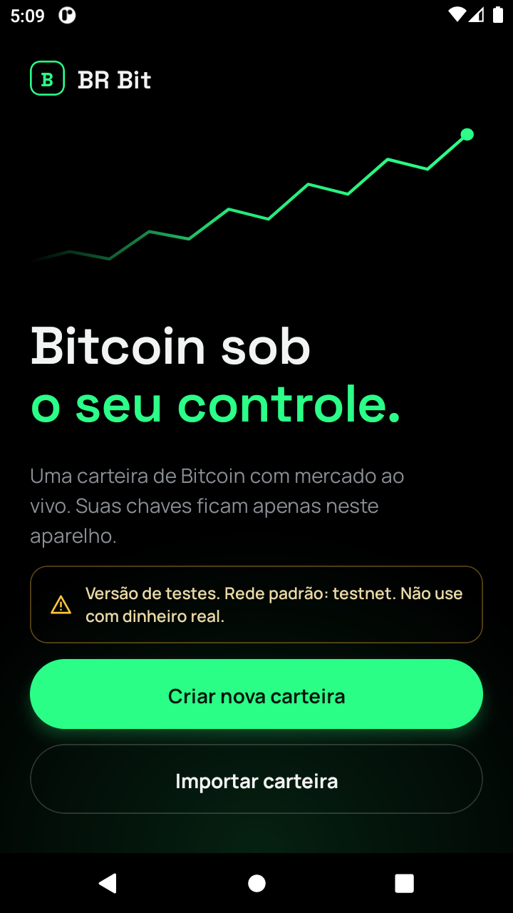
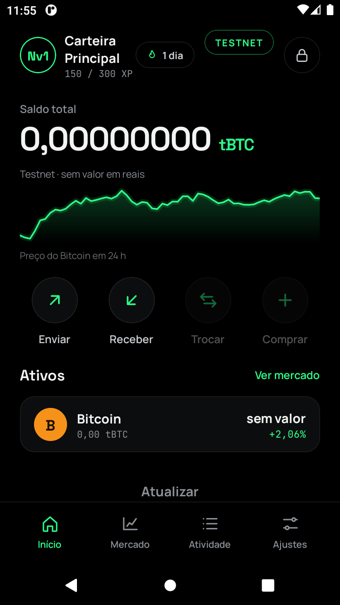
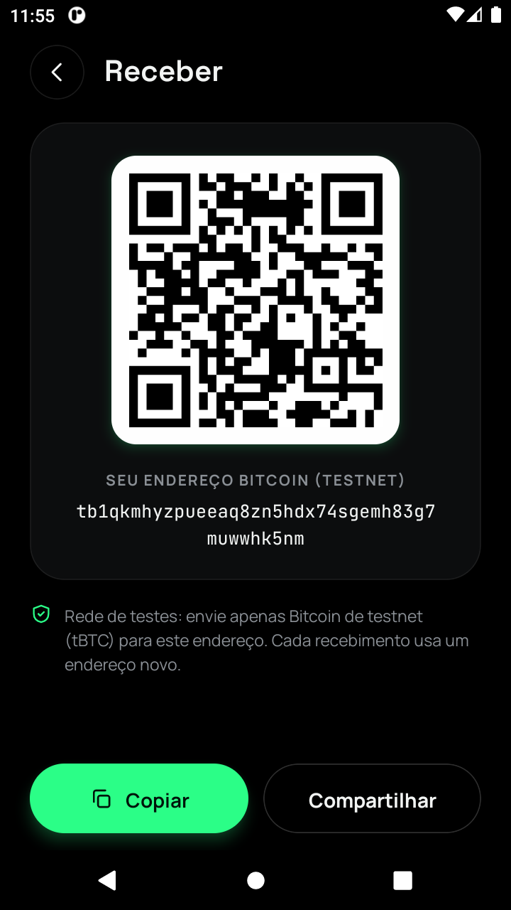
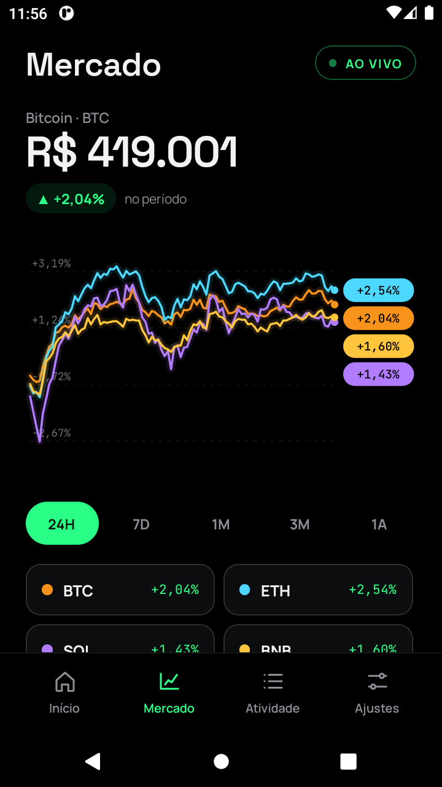
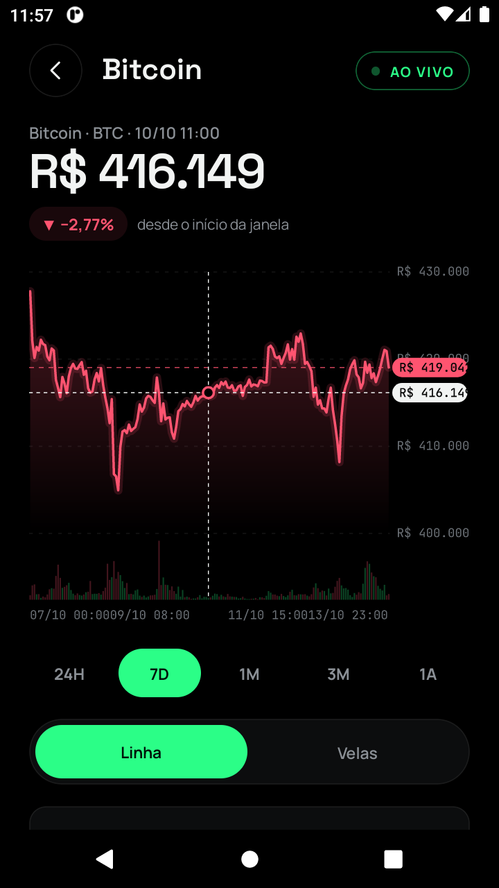

# BR Bit — carteira Bitcoin (React Native / Expo)

Carteira Bitcoin mobile, de código aberto, com mercado ao vivo. Suas chaves ficam só no aparelho.
Este repositório conta uma história completa de engenharia: **recuperar** um app cujo código-fonte foi
perdido (a partir do APK), **reconstruí-lo do zero** com padrões abertos e **provar** que funciona, com
testes automáticos que rodam num Android de verdade (emulado), na frente de quem estiver olhando.

<p align="center">
  
  
  
  
  
</p>

> **Versão de testes, sem auditoria externa. Rede padrão: testnet. Não use com dinheiro real.**

## O que o app faz

- **Criar carteira** com aviso, frase de 12 palavras (oculta até pedir, com captura de tela bloqueada), **quiz de
  backup** de 3 perguntas e PIN de 6 dígitos com bloqueio exponencial. **Importar** uma frase existente.
- **Receber** (QR, copiar, compartilhar) com endereço Native SegWit (BIP84) calculado no aparelho, sempre visível,
  mesmo sem internet. **Enviar** com revisão, taxa Lenta/Normal/Rápida, MAX, "segure para enviar" e PIN.
- **Mercado ao vivo** em R$: comparativo de variação (%) entre moedas, lista com minigráficos e detalhe com
  **linha ou velas, volume e mira**, em 5 janelas (24H a 1A). **Atividade** com o histórico real da carteira.
- **Ajustes**: nível/XP e conquistas reais, ver a frase de recuperação (com PIN), mainnet/testnet, apagar carteira.

## Arquitetura

```
wallet-core/   núcleo puro em TypeScript (sem React): BIP39/32/84, cofre, PIN, PSBT, política, rede, mercado, gráficos
app/           app Expo (React Native): telas no visual do canvas de design, navegação própria
qa/            robô de teste E2E (adb + uiautomator), servidor de testes, scripts do emulador
emulador/      Android leve (AOSP, 2 GB de RAM) para os testes
docs/          progresso, análise do app original 2.2.0 e capturas de tela
```

Bibliotecas de criptografia: `@scure/*` e `@noble/*` (JavaScript puro, auditadas, sem WASM nem polyfill de Node).

## Segurança (modelo e limites)

| Camada | O que existe | Limite honesto |
|---|---|---|
| Seed | Gerada com `crypto.getRandomValues`; nunca em variável de módulo; cofre `scrypt` + XChaCha20-Poly1305 | Um PIN de 6 dígitos não resiste a ataque offline sozinho: a proteção real é o Keystore do sistema |
| PIN | Regras (sem sequências/repetições), bloqueio **exponencial** (30 s, 60 s…), contador persistente, apagamento no limite | JavaScript não garante apagar memória |
| Telas secretas | Captura e gravação de tela bloqueadas na frase, no quiz e no PIN | — |
| Envio | Revisão, endereço em blocos, "segure para enviar", PIN, **nunca repete uma transmissão às cegas** | Sem RBF/CPFP |
| Rede | Respostas validadas campo a campo, recuo exponencial, limite de requisições simultâneas | Depende do mempool.space e da Binance |
| Agente (Claude) | Política `evaluateSpend`: agente **desligado por padrão**, limites por transação e por 24 h, lista de destinos, aprovação humana | Ainda não conectado à interface |

## Como foi testado

**185 testes offline** (`wallet-core`, `npm test`) incluindo vetores oficiais dos BIPs e **verificação cruzada** com
`bitcoinjs-lib`; **23 testes ao vivo** (`npm run test:live`) contra a blockchain real (testnet4 e mainnet, só gerando
endereços descartáveis) e contra duas fontes de preço independentes.

**Testes E2E no emulador** (`qa/`), com toques visíveis na tela e vigia que falha na hora com diagnóstico em arquivo:

| Script | Cobre |
|---|---|
| `e2e-create-wallet.ps1` | aviso, frase oculta, quiz (certa/errada/voltar), PIN fraco/divergente, tela "Carteira criada" |
| `e2e-address-onchain.ps1` | o endereço mostrado na tela existe e é válido no scanner (testnet4 e mainnet); bate com derivação independente |
| `e2e-lock-unlock.ps1` | PIN errado, bloqueio que dobra (30→60 s), sobrevive a reabrir o app, trava de desempenho do desbloqueio |
| `e2e-navigation.ps1` | abas, botão Voltar do Android, Mercado (comparativo, lista, velas, mira), Atividade, ver frase |
| `e2e-import.ps1` | frase inválida (checksum, palavra fora da lista), 24 palavras, maiúsculas/espaços, endereço = derivação independente |
| `e2e-autolock.ps1` | bloqueio automático em segundo plano (< 30 s volta direto; > 30 s volta bloqueada) |
| `e2e-erase.ps1` | apagar a carteira: cancelar não apaga, confirmar apaga, reabrir sem cofre nem PIN |
| `e2e-send.ps1` | formulário, MAX, "segure para enviar", PIN, **assinatura verificada por outra biblioteca**, troco, taxa, falha de rede sem duplicar |

Bugs reais achados por esses testes (e corrigidos) estão em [`docs/PROGRESSO.md`](docs/PROGRESSO.md): o app preso em
HTTP 429 na mainnet, o botão Voltar que fechava o app, o desbloqueio de ~50 s, entre outros.

## APK para celular

O release arm64 autônomo (JavaScript embutido, assinado com chave própria) foi conferido com o REA: sem `debuggable`, sem HTTP sem TLS, backup desligado, sem `SYSTEM_ALERT_WINDOW`. Detalhes em [`docs/SEGURANCA.md`](docs/SEGURANCA.md). **Ainda não foi testado em aparelho real.**

## Como rodar

```powershell
# núcleo
cd wallet-core; npm install; npm test; npm run build

# emulador leve + app
powershell -File emulador\setup-emulador.ps1       # uma vez
powershell -File qa\metro.ps1 -Mode normal          # servidor de desenvolvimento
powershell -File qa\e2e-create-wallet.ps1           # teste na tela do emulador
```

## O app original (BR Bit 2.2.0)

O código-fonte do app original foi perdido; só restou o APK instalado. A análise (REA/JADX para o lado Android e
`hermes-dec` para o bytecode Hermes do JavaScript) está em [`docs/ANALISE-APP-2.2.0.md`](docs/ANALISE-APP-2.2.0.md):
mapa de telas, serviços e o que o app novo já espelha. Nenhum código foi copiado do bytecode decompilado.

## Próximos passos

Solana e memecoins (aparecem no design como "em breve"), biometria ligada ao Keystore, RBF/CPFP, auditoria externa
e a conexão do agente Claude à política de gastos.
