<div align="center">

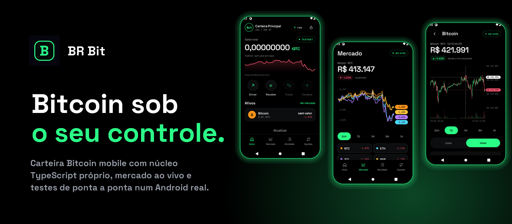

<br/>


**Carteira Bitcoin mobile, de código aberto, com mercado ao vivo. As chaves nunca saem do aparelho.**

[Telas](#telas) · [Arquitetura](#arquitetura) · [Segurança](#segurança) · [Testes](#como-foi-provado-que-funciona) · [Infraestrutura](#infraestrutura-e-engenharia) · [Limites](#o-que-ainda-não-está-resolvido)

</div>

> **Versão de testes, sem auditoria externa. Rede padrão: testnet. Não use com dinheiro real.**

---

## Resumo em 30 segundos

| | |
|---|---|
| **O que é** | Carteira Bitcoin (Native SegWit, BIP84) para Android: criar/importar, receber, enviar, mercado ao vivo e histórico |
| **Por que existe** | O código-fonte de um app anterior (BR Bit 2.2.0) foi perdido. Só restou o APK. Eu o analisei, mapeei o que ele fazia e **reconstruí do zero** com padrões abertos |
| **Diferencial técnico** | Núcleo criptográfico próprio em TypeScript puro, **verificado contra outra implementação** (`bitcoinjs-lib`) e contra a **blockchain real** |
| **Como provei** | **185** testes unitários, **23** testes ao vivo, **8** suítes E2E rodando num Android emulado, com um robô que reage a falhas em vez de travar |
| **Segurança** | Cofre `scrypt` + XChaCha20-Poly1305, PIN com bloqueio exponencial, captura de tela bloqueada, revisão com **REA/JADX** e mapa **OWASP MASVS** |
| **Honestidade** | Há uma seção inteira com o que **não** está resolvido. Leia antes de usar com dinheiro |

---

## Telas

<p align="center">
  
  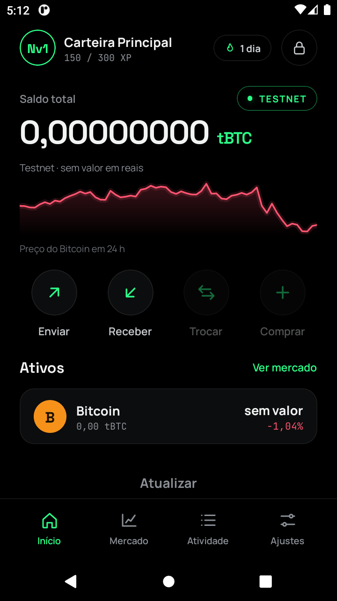
  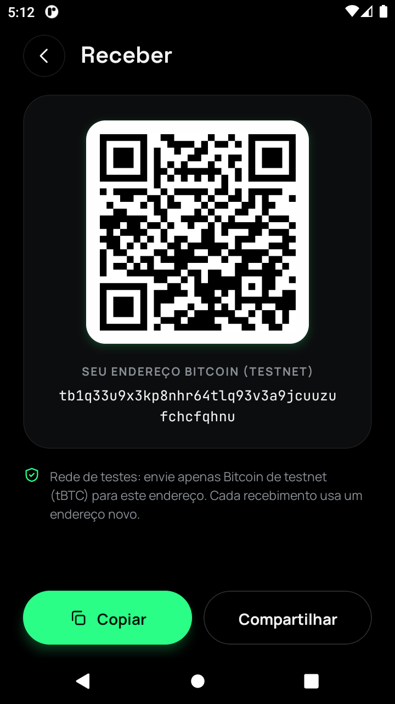
  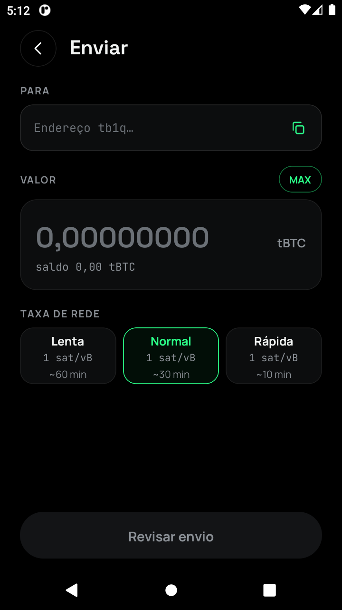
  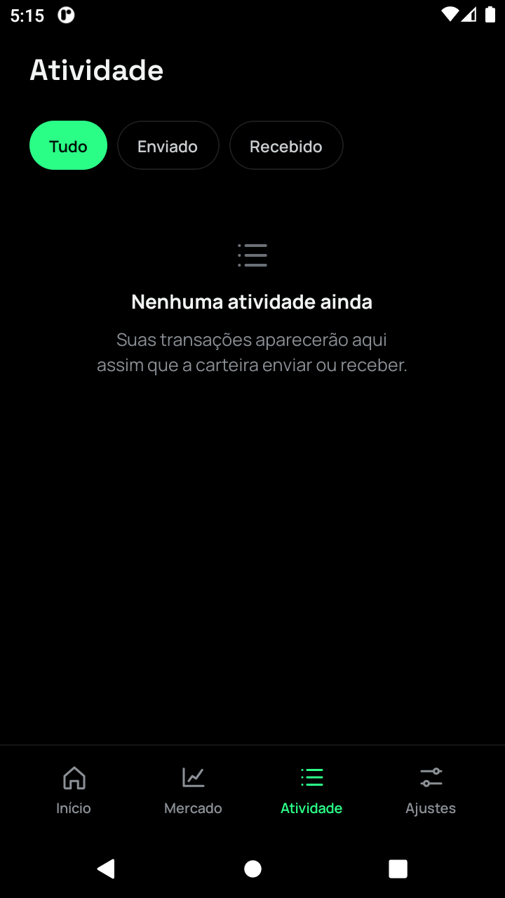
</p>
<p align="center">
  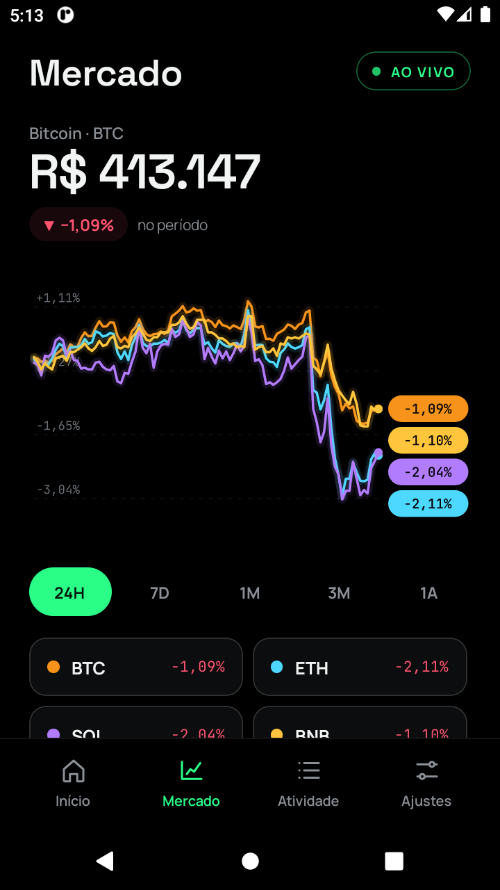
  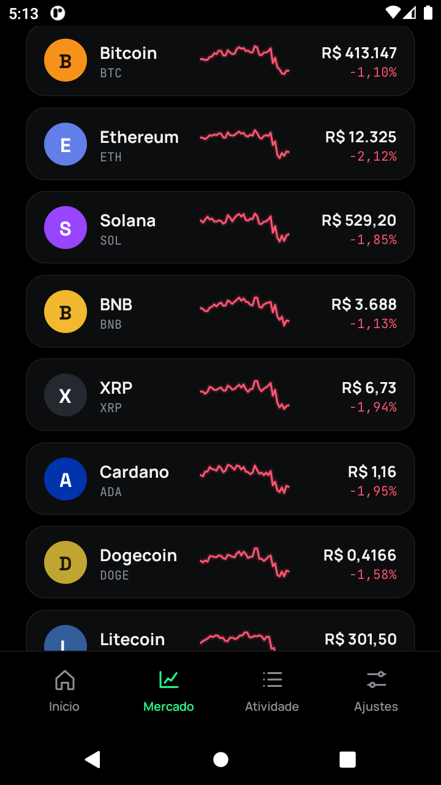
  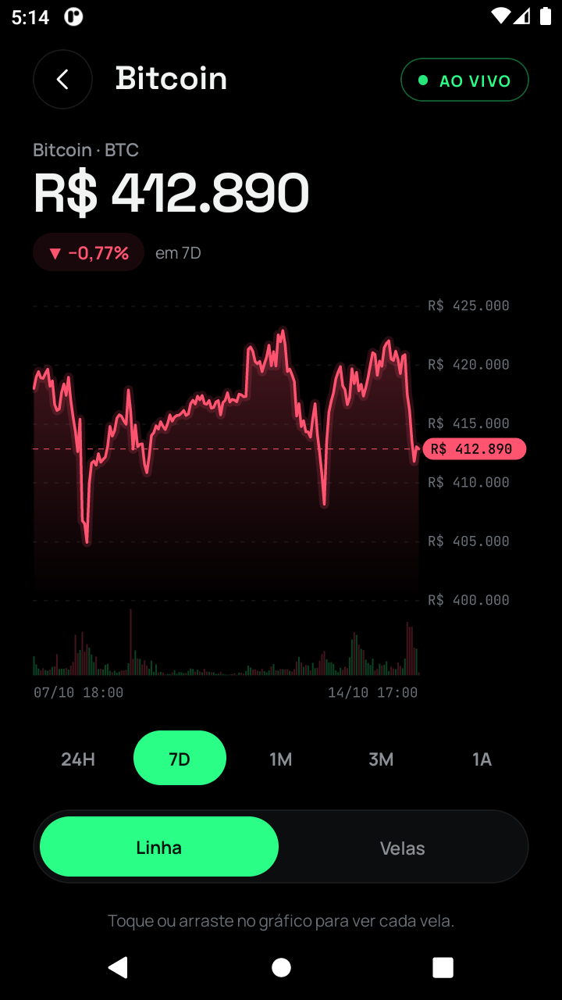
  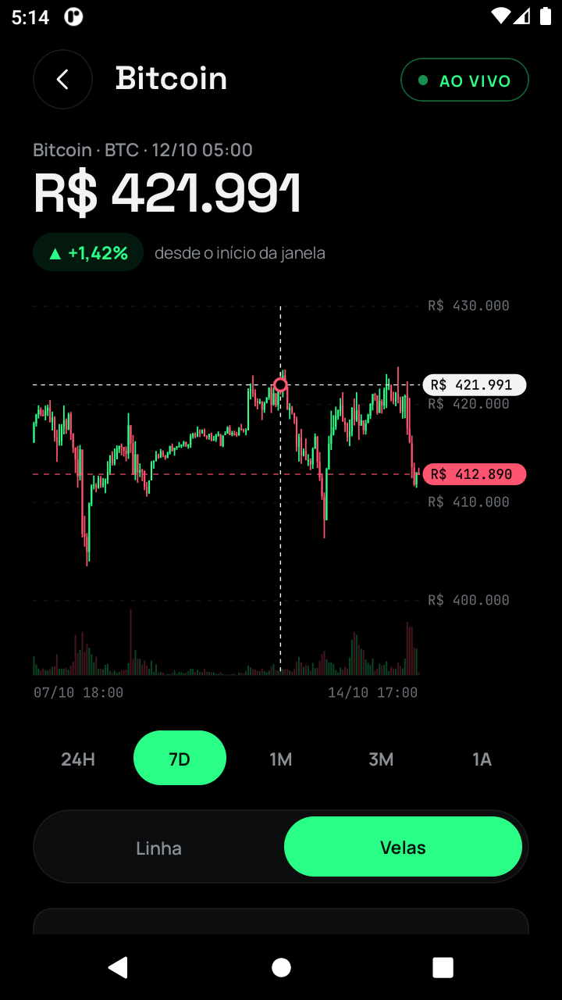
  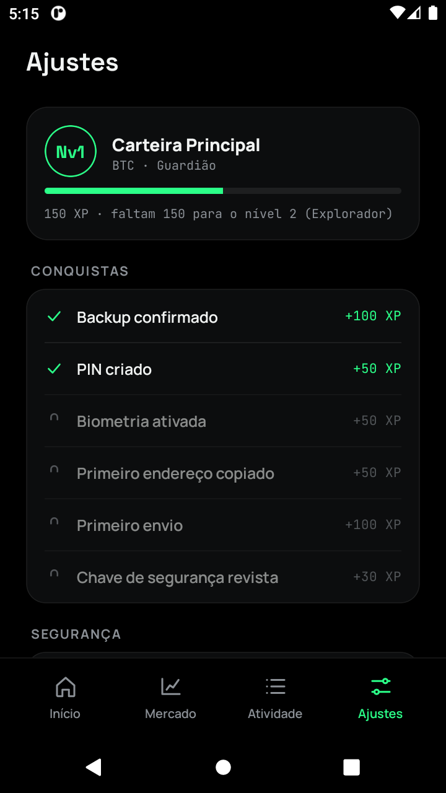
</p>

<sub>Capturas reais do app rodando num Android emulado (testnet, carteira descartável). As telas da frase de recuperação, do quiz, do PIN e da importação **bloqueiam captura de tela** (`FLAG_SECURE`), por isso não aparecem aqui.</sub>

**Visual:** preto com verde neon (`#2BFF88`), Space Grotesk, Manrope e JetBrains Mono. Gráficos desenhados em SVG (linha, velas, volume, mira, comparativo em %), sem biblioteca de gráficos.

---

## O que o app faz

- **Criar carteira** com aviso, frase de 12 palavras (oculta até pedir), **quiz de backup** de 3 perguntas e PIN de 6 dígitos. **Importar** frase de 12 ou 24 palavras.
- **Receber** com QR, copiar e compartilhar. O endereço é **calculado no aparelho** e aparece mesmo sem internet.
- **Enviar** com revisão, taxa Lenta/Normal/Rápida, MAX, "segure para enviar" e PIN.
- **Mercado ao vivo em R$**: comparativo de variação entre moedas, lista com minigráficos, detalhe com linha ou velas, volume e mira, em 5 janelas (24H a 1A).
- **Atividade** com o histórico real da carteira. **Ajustes** com nível/XP, ver frase (com PIN), trocar rede e apagar carteira.

---

## Arquitetura

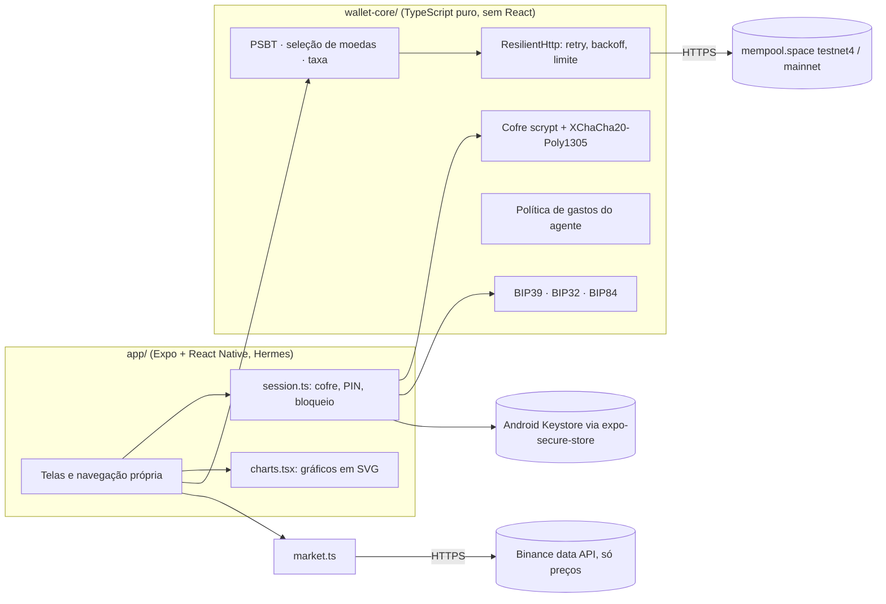

```text
wallet-core/   núcleo puro: chaves, cofre, PIN, transação, política, rede, mercado, gráficos (sem React)
app/           app Expo: telas no visual do design, navegação própria, plugin de manifest endurecido
qa/            robô de teste E2E (adb + uiautomator), servidor de testes da testnet, scripts do emulador
emulador/      Android leve (AOSP, 2 GB de RAM) para os testes
docs/          progresso, análise do app 2.2.0, segurança e capturas
```

**Decisão central:** toda a lógica que importa para o dinheiro fica no `wallet-core`, sem dependência de React nem de Node. Isso a torna testável sozinha, auditável por quem só quer ler esse pacote e portável.

---

## Segurança

| Camada | O que existe |
|---|---|
| **Seed** | Gerada com `crypto.getRandomValues`, nunca em variável de módulo. Guardada num cofre `scrypt` + XChaCha20-Poly1305 dentro do Android Keystore |
| **PIN** | 6 dígitos, sem sequências ou repetições. Bloqueio **exponencial** (30 s, 60 s…) **persistente**: fechar o app não zera o contador |
| **Telas secretas** | Frase, quiz, PIN e importação bloqueiam captura e gravação de tela |
| **Envio** | Revisão, endereço em blocos, "segure para enviar", PIN e **nunca repete uma transmissão às cegas** (uma falha no meio pode já ter transmitido) |
| **Rede** | Só HTTPS no release, respostas validadas campo a campo, recuo exponencial com `Retry-After`, no máximo 2 consultas simultâneas |
| **Manifest** | `allowBackup=false`, sem tráfego sem TLS, sem `debuggable`, sem `SYSTEM_ALERT_WINDOW`, sem permissões de armazenamento, provedor de arquivos exportado removido |
| **Agente (Claude)** | Política `evaluateSpend`: agente desligado por padrão, limite por transação e por 24 h, lista de destinos, aprovação humana |

**Revisão:** o próprio APK foi analisado com **REA (JADX)** e os achados (backup ligado, provedor exportado, permissões sem uso, `SYSTEM_ALERT_WINDOW`) foram corrigidos e **reconferidos no APK de release**. Mapa completo em [`docs/SEGURANCA.md`](docs/SEGURANCA.md).

---

## Como foi provado que funciona

<table>
<tr><td width="33%" valign="top">

**Núcleo (offline)**

185 testes com vetores oficiais dos BIPs, cofre adulterado, parâmetros de KDF maliciosos, respostas hostis de servidor e injeção de caminho.

</td><td width="33%" valign="top">

**Contra a realidade**

23 testes ao vivo: endereços conferidos no scanner da **testnet4** e da **mainnet** (só gerando endereços descartáveis, nada movimentado) e preços contra duas fontes.

</td><td width="33%" valign="top">

**Verificação cruzada**

Derivação de endereços e **assinaturas ECDSA** conferidas com `bitcoinjs-lib`, uma segunda implementação independente (low-S, `SIGHASH_ALL`).

</td></tr>
</table>

**8 suítes E2E num Android emulado**, com toques visíveis na tela:

| Script | O que prova |
|---|---|
| `e2e-create-wallet` | aviso, frase oculta, quiz, PIN fraco/divergente, "Carteira criada" |
| `e2e-address-onchain` | o endereço da tela existe e é válido no scanner; bate com derivação independente |
| `e2e-lock-unlock` | PIN errado, bloqueio que dobra, sobrevive a reabrir o app, trava de desempenho |
| `e2e-navigation` | abas, botão Voltar, Mercado, Atividade, ver frase |
| `e2e-import` | frase inválida, 24 palavras, maiúsculas e espaços, endereço = derivação independente |
| `e2e-send` | validações, MAX, "segure para enviar", **assinatura verificada por outra biblioteca**, troco, taxa, falha sem duplicar |
| `e2e-autolock` | em segundo plano: menos de 30 s volta direto, mais de 30 s volta bloqueada |
| `e2e-erase` | cancelar não apaga, confirmar apaga, reabrir sem cofre nem PIN |

<details>
<summary><b>O robô que não trava</b> (clique para ver)</summary>

Testes instáveis eram um problema real, então o robô tem um **vigia** (`Wait-Until`): uma mensagem de erro conhecida na tela falha na hora, uma tela parada falha, o diálogo "app não responde" do Android é dispensado sozinho e toda falha grava um diagnóstico (tela, foco, log do app) em `qa/out/`, **sem nunca gravar a frase secreta**. Digitação em pedaços, leitura do teclado uma vez só e medição de tempo real do bloqueio vieram de bugs do próprio robô, todos listados em [`docs/PROGRESSO.md`](docs/PROGRESSO.md).

</details>

### Bugs reais que os testes acharam (e foram corrigidos)

| Bug | Causa raiz |
|---|---|
| App preso em **HTTP 429** na mainnet, sem mostrar o endereço | Dezenas de consultas seguidas, sem retry nem limite. Agora: backoff, varredura mínima, endereço sempre local, cache |
| Botão **Voltar** do Android fechava o app | Navegação própria sem `BackHandler`. Agora há um mapa de "voltar" por tela |
| **Desbloquear levava ~50 s** | `scrypt` 2^14 em JS puro + recálculo da seed a cada abertura. Agora 2^12 e a seed vai pronta no cofre (**~8 s** no emulador) |
| 5º erro de PIN não avisava o bloqueio | O resultado da tentativa não informava que ela mesma acionou o bloqueio |
| "Voltar" no quiz **gerava 12 palavras novas** | A tela sorteava o mnemônico a cada montagem |

---

## Infraestrutura e engenharia

| Área | Escolha |
|---|---|
| **App** | Expo SDK 52, React Native 0.76 (Hermes, nova arquitetura), `expo-secure-store`, `expo-screen-capture`, `react-native-svg` |
| **Núcleo** | TypeScript estrito, `@scure/*` e `@noble/*` (JavaScript puro, auditadas, sem WASM nem polyfill de Node) |
| **Build** | Gradle, release **arm64** com o JavaScript embutido, assinado com chave própria |
| **Emulação** | AVD AOSP (API 30, 2 GB de RAM) com aceleração WHPX, Metro com live reload via `adb reverse` |
| **Engenharia reversa** | **REA/JADX** no APK do app original, `hermes-dec` no bytecode Hermes. Nenhum código foi copiado do bytecode |
| **Windows** | Limite de 260 caracteres do ninja contornado compilando num caminho curto, BOM e PowerShell 5.1 tratados nos scripts |

---

## APK para Android (arm64)

Arquivo: [`download/HotWalletBTC-arm64.apk`](download/HotWalletBTC-arm64.apk) · JavaScript embutido, não precisa de servidor.

```text
SHA-256 do APK:        b6a827b7d3823f519a2be50b3c43224ef146a352501b5a5dbcb06562b0e82a67
Certificado (SHA-256): a6c3aab1a01636b3307f1843e35db02459a5d9724d053ef2df665f6553c08bf6
```

Confira o hash antes de instalar. Versão de testes: use só carteira de teste e valores sem importância.

---

## O que ainda não está resolvido

1. **PIN de 6 dígitos não resiste a ataque offline sozinho.** A defesa real é o Keystore. A biometria ligada ao Keystore **não existe ainda**.
2. **Privacidade de endereços:** cada consulta ao mempool.space revela IP e endereços. A solução (servidor próprio ou Electrum) **não está implementada**.
3. Sem fixação de certificado (pinning).
4. Sem RBF/CPFP: uma transação com taxa baixa pode ficar presa.
5. **Nunca usado na mainnet com fundos.** A mainnet só gerou e validou endereços descartáveis.
6. O agente Claude está testado no núcleo, mas **ainda não está ligado à interface**.
7. Solana, memecoins, Trocar e Comprar aparecem como "em breve".
8. **Sem auditoria externa.**

---

## Como rodar

```powershell
# núcleo
cd wallet-core; npm install; npm test; npm run build

# emulador leve + app
powershell -File emulador\setup-emulador.ps1       # uma vez
powershell -File qa\metro.ps1 -Mode normal          # servidor de desenvolvimento
powershell -File qa\e2e-create-wallet.ps1           # teste na tela do emulador
```

## O app original (BR Bit 2.2.0)

O código-fonte foi perdido. A análise do APK (mapa de telas, serviços e o que o app novo espelha) está em [`docs/ANALISE-APP-2.2.0.md`](docs/ANALISE-APP-2.2.0.md).

## Próximos passos

Biometria ligada ao Keystore, servidor próprio para privacidade, RBF/CPFP, Solana e memecoins, agente Claude conectado à política de gastos e auditoria externa.
